<div align="center">


# WedCount

### WhatsApp RSVPs and an expected headcount for every function of an Indian wedding.

*400 invited. 400 said yes. 280 came. The caterer cooked for 400.*
**WedCount turns "of course we'll come" into a number you can plan food around.**

<br />


### [Live: wedcount.vercel.app](https://wedcount.vercel.app)

[Problem](#the-problem) · [Features](#features) · [How it works](#how-it-works) · [Prediction model](#prediction-model) · [Engineering](#engineering) · [Tech stack](#tech-stack) · [Run locally](#run-locally) · [Documentation](#documentation)

<br />


</div>

---

## The problem

Indian weddings run over several functions (Haldi, Mehendi, Sangeet, Wedding, Reception) with hundreds of guests each. The guest count is still worked out on WhatsApp and gut feel: *"Sharma uncle will come, na?"*

An illustrative function:

| | Guests | |
|---|---:|---|
| Invited | **400** | |
| Said they'd come | **400** | everyone says yes |
| Actually came | **280** | |
| Plates nobody ate | **120** | paid for anyway |

Families spend lakhs on catering, and the one number it depends on is a guess.

## Features

<table>
<tr>
<td width="62%" valign="top">

**For the planner: one screen per wedding**

- A **home page** with what's coming up across all weddings, what needs doing, and the latest replies
- Live **headcount per function**: Coming, veg / non-veg split, Maybe, Can't come, No reply
- An **expected turnout with a likely range**, not just a sum of "yes"
- **WhatsApp invites and reminders** from your own number: a send queue goes guest by guest, with a message you can edit
- **Invite guests to only some functions**, and see **who's coming by name**
- Duplicate guests are caught; replies close before each function's day
- **Caterer CSV**, ready for Excel
- **One shared invite link** for WhatsApp groups: guests add themselves, then reply
- A **door list** for the day: one tap per person who arrives, and the turnout records itself
- A Google Maps link for each venue and a time on the RSVP deadline
- Edit or remove guests, functions and whole weddings; import the family's spreadsheet

</td>
<td width="38%" valign="top">

**For the guest: an invitation, not a form**

- A private link, no app, no login
- A real **wedding invitation** in the couple's chosen theme: tap the seal, families, countdown, scratch-the-gold date, and every function with **Directions** and **Add to calendar**
- Then **Coming / Maybe / Can't come for each function**
- How many people, their names, veg or non-veg, arrival time
- A **thank-you card** with their answers when they save
- Can change their mind until the deadline (never on the function's day)
- The WhatsApp message lists each function's day, time and venue, and the link previews as a card in the wedding's theme

</td>
</tr>
</table>


<table>
<tr>
<td width="25%">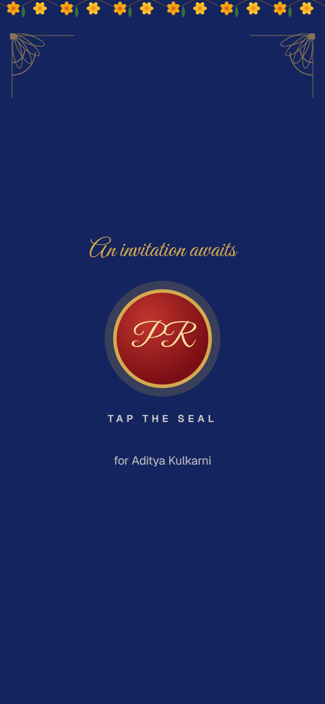</td>
<td width="25%"></td>
<td width="25%"></td>
<td width="25%" valign="middle">

**Built for the phone first**

Guests open their link from WhatsApp and get a real invitation: tap the seal, the couple and their families, a countdown and a gold card to scratch for the date, in one of four themes. It works on any phone, even before it finishes loading.

Planners get card layouts instead of cramped tables, sticky section tabs that follow the scroll, and full-width actions.

</td>
</tr>
</table>

<table>
<tr>
<td width="33%">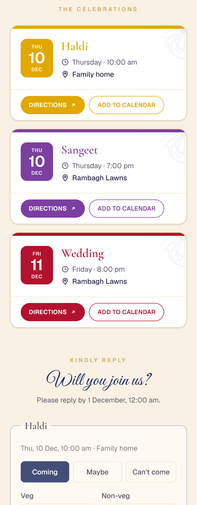</td>
<td width="33%">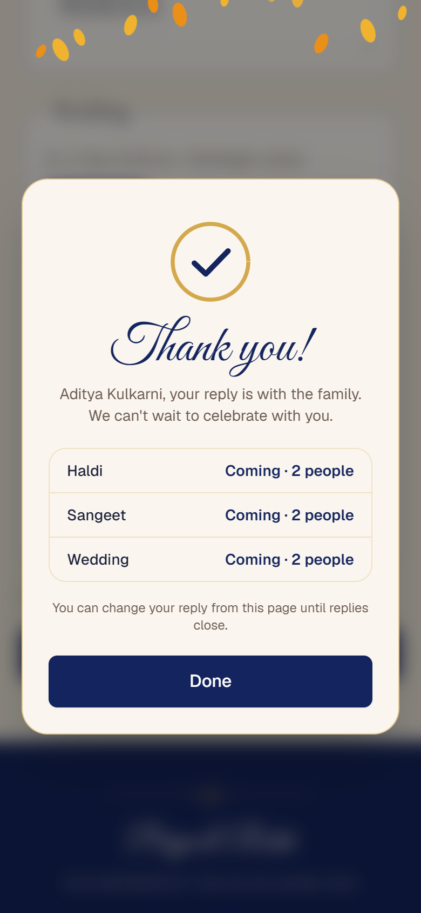</td>
<td width="33%">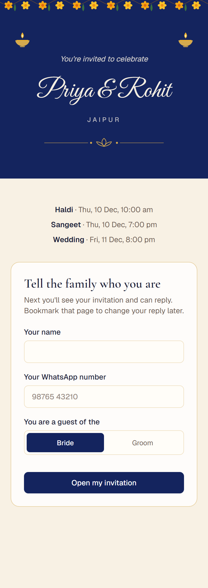</td>
</tr>
</table>

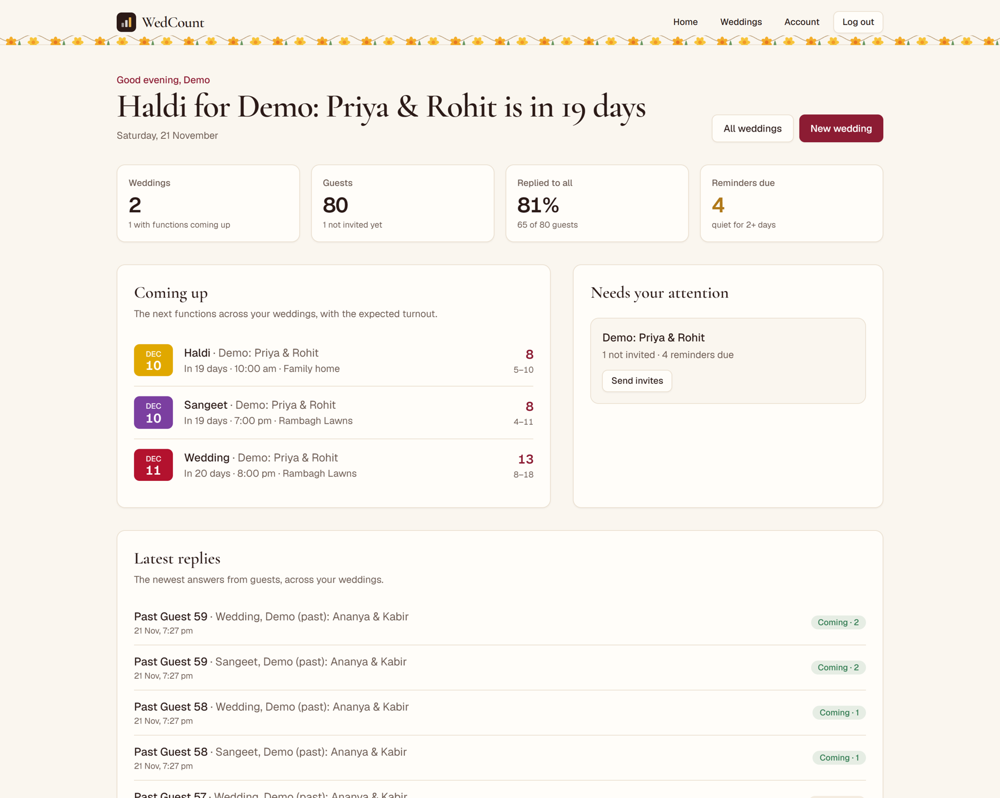

<table>
<tr>
<td width="30%">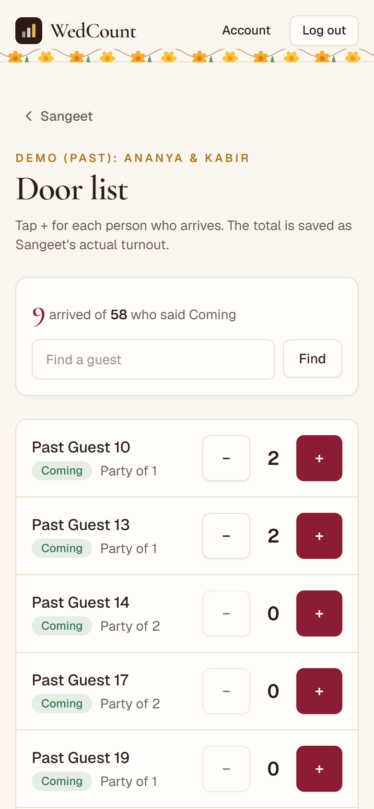</td>
<td width="70%" valign="middle">

**On the day: a door list**

Open a function's door list on your phone and tap **+** for each person who arrives (**−** to undo). Search finds a guest or anyone named in their reply. The total becomes that function's actual turnout, so the prediction learns from the real numbers without anyone typing them in.

</td>
</tr>
</table>

<table>
<tr>
<td width="50%">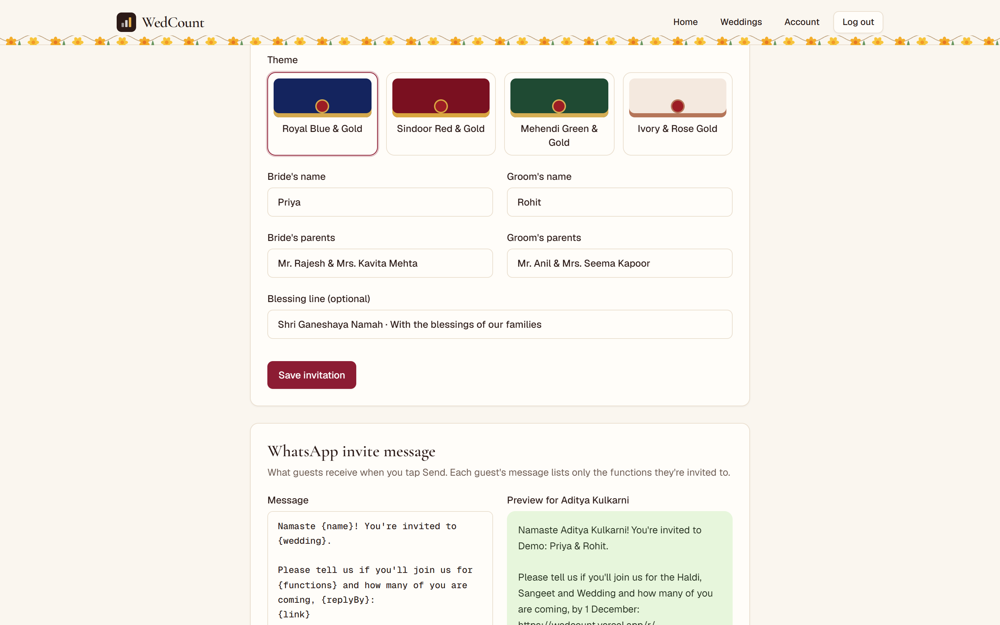</td>
<td width="50%">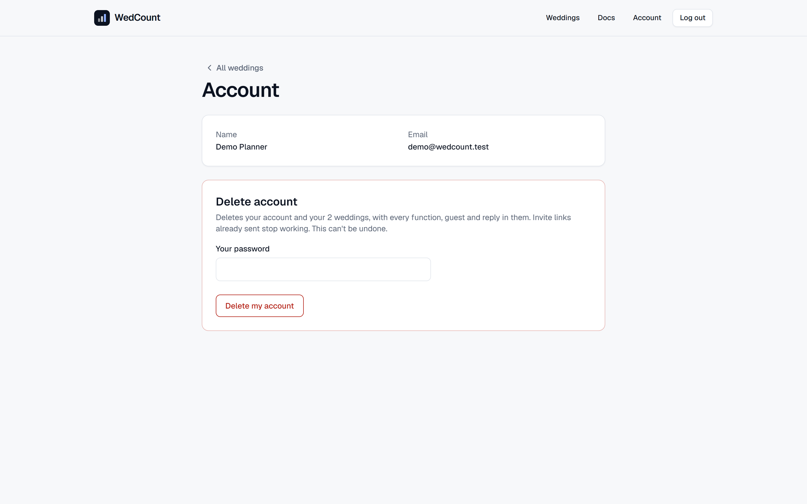</td>
</tr>
</table>

## How it works

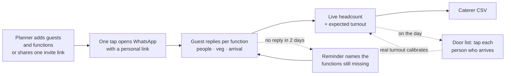

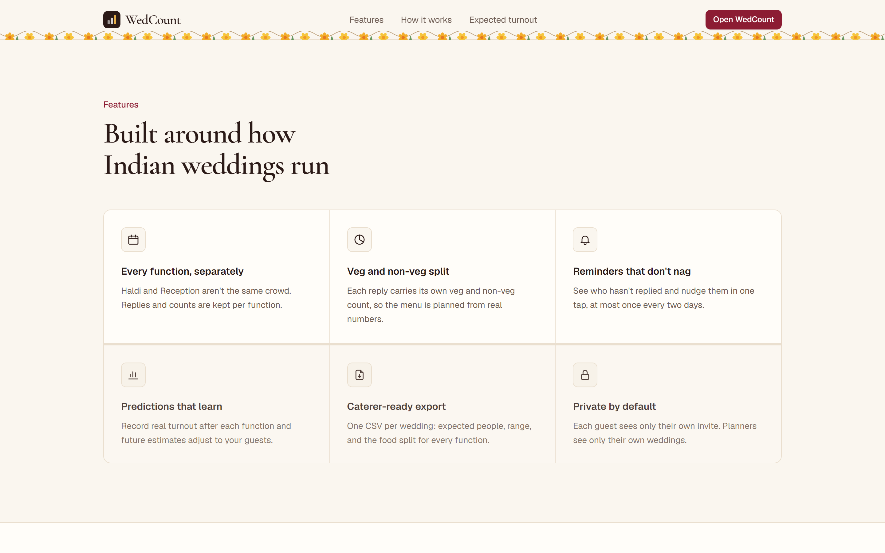

## Prediction model

RSVPs overpromise: people say "Coming" and don't show, and some who never replied turn up. Each guest's **party** (everyone on one invite) either comes or doesn't, with a probability that depends on their answer and how they're related:

| Show rate | Family | Friend | Colleague | Other |
|---|:---:|:---:|:---:|:---:|
| **Coming** | 0.95 | 0.85 | 0.75 | 0.80 |
| **Maybe** | 0.60 | 0.45 | 0.30 | 0.40 |
| **No reply** | 0.35 | 0.20 | 0.10 | 0.15 |

```text
expected = Σ size × p                          (No reply uses the function's average party size)
range    = expected ± 1.645 × √( Σ size² × p × (1 − p) )   ≈ 90%, parties treated as independent
```

**It learns.** After each function the planner enters how many people actually came, and future predictions scale by

```text
factor = (Σ actual + 100) / (Σ predicted + 100),  capped to 0.5 – 1.5
```

across all of that planner's past functions. The `+100` stops one odd function from swinging everything.

> **Honest by design.** The show rates above are starting assumptions, not measured data, and the app says so on the page. For every recorded function it shows the prediction's error next to the naive "count only Coming" number, so accuracy is shown, not claimed.

## Engineering

<details open>
<summary><b>Security</b></summary>

- Passwords hashed with **scrypt** (Node built-in). Sessions live in the database; only a **SHA-256 of the cookie token** is stored, so a leaked DB can't log anyone in.
- Guest invite tokens are **128 random bits**: the link is the guest's only credential.
- Every query is **scoped to the logged-in planner**; another planner's wedding returns 404, so ids can't be probed. A database test proves it.
- **Password reset** by one-time email link (Resend): 256-bit token stored hashed, 30 minutes, single use, signs out other devices.
- **Signup, reset and join limits** per network per hour, counted by **one atomic SQL statement** (a test fires 12 parallel requests and exactly 5 pass); only a hash of the address is stored.
- **Login lockout** after 5 wrong passwords, stored in the DB so it holds across serverless instances. Every failure shows the same message, so nobody can tell which emails have accounts.
- CSV export is **formula-injection safe**; unique-constraint races give a clear message instead of a crash.

</details>

<details>
<summary><b>Correctness</b></summary>

- RSVP rules, CSV parsing (RFC 4180, quoted names with commas), phone normalisation (`98765 43210` and `+91-98765-43210` are the same guest), reminders, headcount and the prediction model are **pure functions with unit tests**.
- Saves are **transactions**: a guest never ends up with half their functions saved. Door check-ins recompute the turnout in one statement, so parallel taps always add up.
- **GitHub Actions** runs lint, unit tests, database tests and the build against Postgres on every pull request.
- Dates are handled in **IST** throughout (deadline = end of that day in India).
- Forms keep a **server action fallback**, so a tap before the page finishes loading on a slow phone still saves.

</details>

<details>
<summary><b>Design system</b></summary>

- Warm wedding **tokens** in `app/globals.css` (ivory, maroon, marigold gold); components in `app/ui/kit.tsx`; four invitation themes under `[data-invite]`.
- Cormorant Garamond headings, Great Vibes for the couple's names, Geist for text and numbers.
- The landing page is plain server-rendered HTML that shows the product's real UI; no animation library.
- Motion is hover states, short reveals on the browser's **native scroll timelines**, and a few one-time moments on the invitation (doors, petals, the thank-you tick), all off under **reduced motion**.

</details>

## Tech stack

| Layer | Choice |
|---|---|
| Framework | Next.js 16 (App Router, Server Actions, Cache Components), React 19 |
| Language | TypeScript |
| Data | Prisma 6 · Postgres on Neon (local: `npx prisma dev`, no Docker) |
| Hosting | Vercel (functions in Singapore, `sin1`), Neon in Singapore |
| Monitoring | Vercel Web Analytics, Speed Insights, structured error logs (`instrumentation.ts`) |
| UI | Tailwind CSS v4, design tokens, Cormorant Garamond + Great Vibes + Geist, hand-drawn SVG ornaments |
| Messaging | WhatsApp `wa.me` deep links (no paid API needed) |
| Email | Resend REST API, for password reset only |
| Tests | Node's built-in test runner via `tsx` |

```text
app/
  _landing/      marketing page
  home/, dashboard/  planner home and weddings
  weddings/[id]/ headcount, invites, functions, guests, door list, caterer CSV export
  r/[token]/     the guest's invitation and RSVP (public, token = credential)
  w/[code]/      the wedding's shared invite link
  docs/, llms*/  documentation for people and AI agents
  privacy/, terms/  legal pages
  ui/            design-system kit, forms, cursor, section tabs
lib/             pure logic: rsvp, guests/CSV, headcount, predict, reminders, invite, invitation, checkin, ratelimit, lockout, docs (+ tests)
docs/            agents, requirements, features, architecture, decision, playbook, hacks, tips
prisma/          schema, migrations, demo seed
```

## Run locally

```bash
npm install
cp .env.example .env
npx prisma dev --name wedcount --detach   # local Postgres, no Docker
npx prisma migrate deploy
npx prisma db seed
npm run dev
```

Open **http://localhost:3000** and log in with the local demo account: `demo@wedcount.test` / `demo-planner-123`.

```bash
npm test          # 66 unit tests
npm run test:db   # 7 database tests in a throwaway Postgres schema
npm run lint
npm run build
```

> After editing `app/globals.css`, restart the dev server (and delete `.next` if styles look stale): this setup does not hot-reload stylesheet changes.

<details>
<summary><b>Guest CSV format</b></summary>

```csv
name,phone,side,relation
Sharma Uncle,98765 43210,bride,family
"Sharma, Ramesh",+91 90000 11111,groom,friend
```

- `side` is `bride` or `groom`; `relation` is `family`, `friend`, `colleague` or `other` (default).
- Any common Indian mobile format; stored as `+91XXXXXXXXXX`.
- If any row is invalid, nothing is imported and errors give the file's line number. Guests already on the list are skipped.

</details>

## Documentation

Everything about the project lives in [`docs/`](docs) as Markdown, rendered in the app at `/docs` and served to AI agents at `/llms.txt`.

| Doc | What it answers |
|---|---|
| [Agent guide](docs/agents.md) | How AI agents should work here: read order, hard rules, decision protocol |
| [Requirements](docs/requirements.md) | Users, functional and non-functional requirements |
| [Features](docs/features.md) | Every feature and where its code lives |
| [Architecture](docs/architecture.md) | System design, data model, flows, security |
| [Decision log](docs/decision.md) | Why things are the way they are |
| [Playbook](docs/playbook.md) | Run, ship, migrate, deploy to Vercel + Neon, run a real wedding |
| [Hacks](docs/hacks.md) and [Tips](docs/tips.md) | Known shortcuts, traps and practical advice |

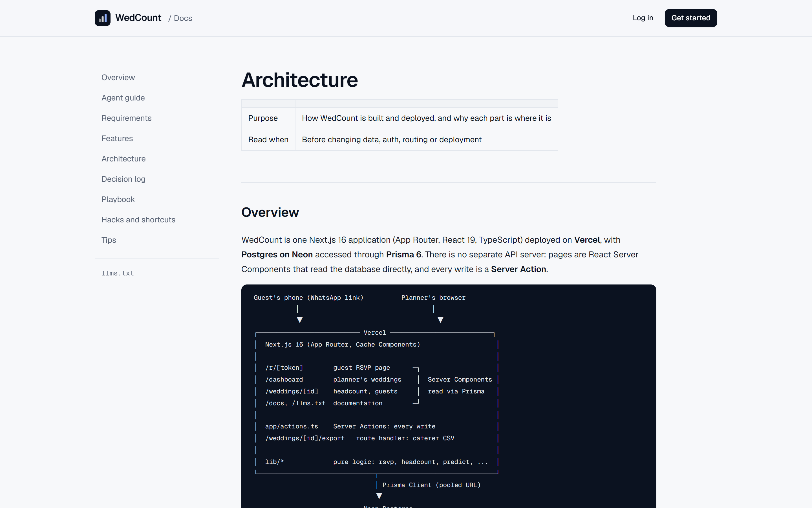

## Roadmap

- Automatic WhatsApp sending through the Cloud API, with delivery receipts
- A Hindi guest page
- Several planners sharing one wedding
- Pilot at a real wedding: record turnout with the door list and publish predicted against actual

<div align="center">
<br />

<br />
<sub>Made in India, for Indian weddings.</sub>
</div>
