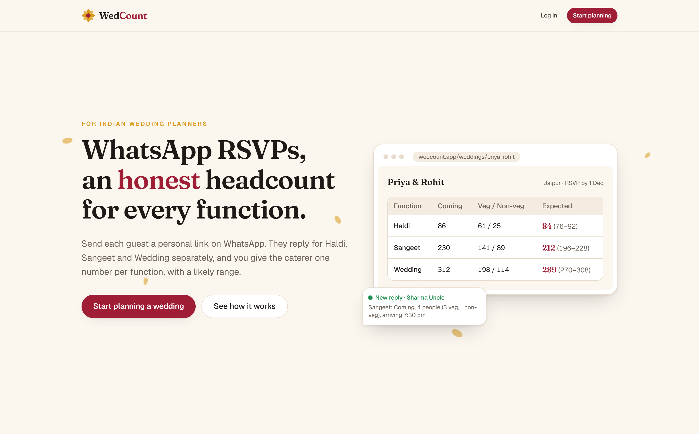
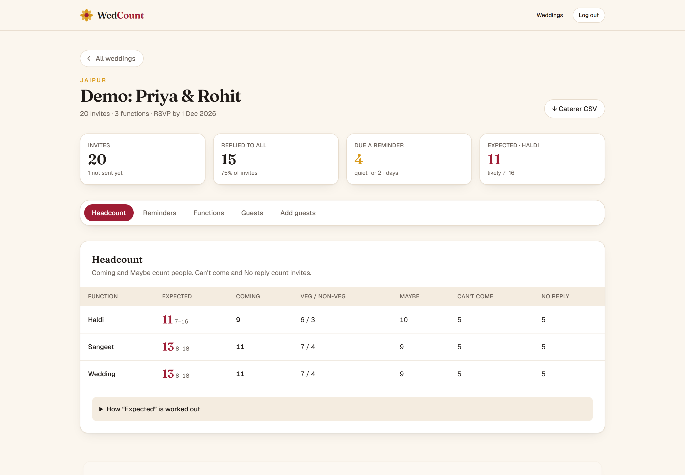
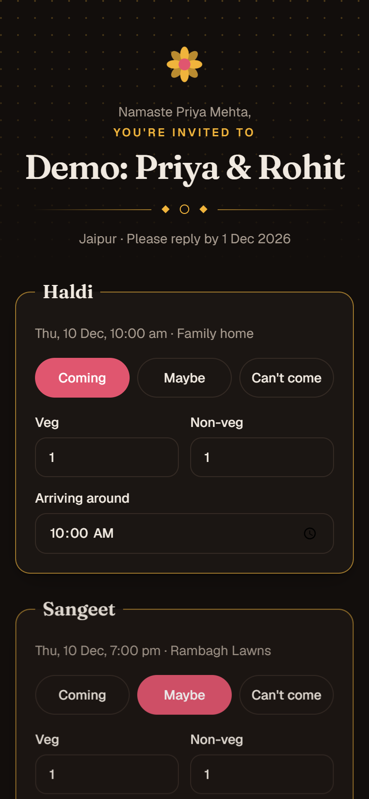
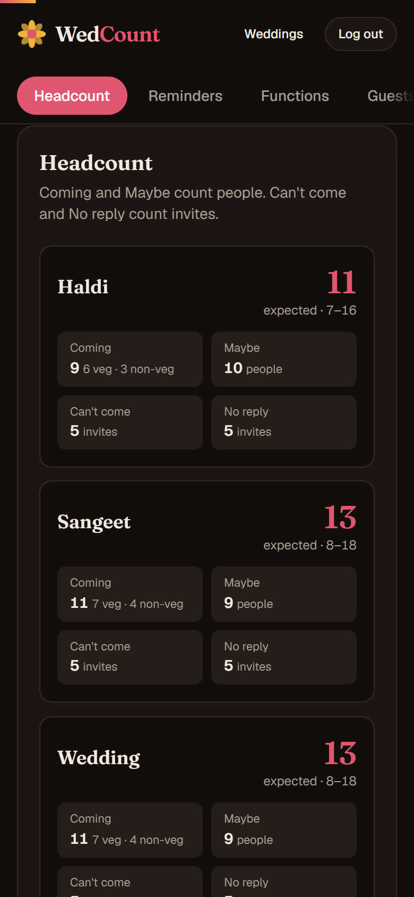
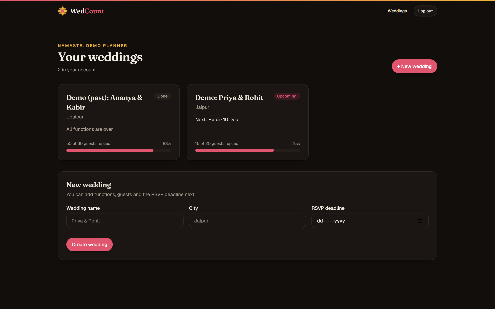
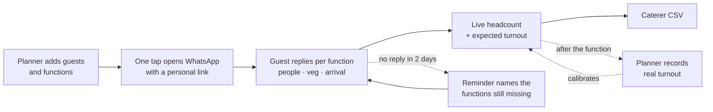
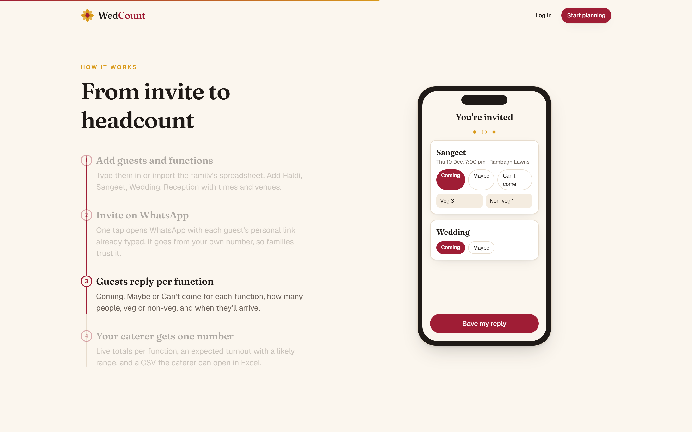

<div align="center">


# WedCount

### WhatsApp RSVPs and an honest headcount for every function of an Indian wedding.

*400 invited. 400 said yes. 280 came. The caterer cooked for 400.*
**WedCount turns "of course we'll come" into a number you can plan food around.**

<br />


[The problem](#-the-problem) · [Features](#-what-it-does) · [How it works](#-how-it-works) · [Prediction model](#-the-prediction-model) · [Engineering](#-engineering-highlights) · [Run it](#-run-it-locally)

<br />

<picture>
  <source media="(prefers-color-scheme: dark)" srcset="docs/screenshots/landing-dark.png" />
  
</picture>

</div>

---

## 🪔 The problem

Indian weddings run over several functions (Haldi, Mehendi, Sangeet, Wedding, Reception) with hundreds of guests each. The guest count is still worked out on WhatsApp and gut feel: *"Sharma uncle will come, na?"*

| | Guests | |
|---|---:|---|
| Invited | **400** | |
| Said they'd come | **400** | everyone says yes |
| Actually came | **280** | |
| Plates nobody ate | **120** | paid for anyway |

Families spend lakhs on catering, and the one number it depends on is a guess.

## ✨ What it does

<table>
<tr>
<td width="62%" valign="top">

**For the planner: one screen per wedding**

- Live **headcount per function**: Coming, veg / non-veg split, Maybe, Can't come, No reply
- An **expected turnout with a likely range**, not just a sum of "yes"
- **One-tap WhatsApp invites and reminders** from your own number
- **Caterer CSV**, ready for Excel
- Edit or remove guests and functions; import the family's spreadsheet

</td>
<td width="38%" valign="top">

**For the guest: an invitation, not a form**

- A private link, no app, no login
- **Coming / Maybe / Can't come for each function**
- How many people, veg or non-veg, arrival time
- Can change their mind until the deadline

</td>
</tr>
</table>



<table>
<tr>
<td width="33%"></td>
<td width="33%"></td>
<td width="34%" valign="middle">

**Built for the phone first**

Guests open their link from WhatsApp, so the RSVP page is designed as an invitation that works on any phone, even before it finishes loading.

Planners get card layouts instead of cramped tables, sticky section tabs that follow the scroll, and full-width actions.

Light and dark themes follow the device.

</td>
</tr>
</table>



## 🧭 How it works





## 📈 The prediction model

RSVPs overpromise: people say "Coming" and don't show, and some who never replied turn up. Each guest's **party** (everyone on one invite) either comes or doesn't, with a probability that depends on their answer and how they're related:

| Show rate | Family | Friend | Colleague | Other |
|---|:---:|:---:|:---:|:---:|
| **Coming** | 0.95 | 0.85 | 0.75 | 0.80 |
| **Maybe** | 0.60 | 0.45 | 0.30 | 0.40 |
| **No reply** | 0.35 | 0.20 | 0.10 | 0.15 |

```text
expected = Σ size × p                          (No reply uses the function's average party size)
range    = expected ± 1.645 × √( Σ size² × p × (1 − p) )   ≈ 90%, parties treated as independent
```

**It learns.** After each function the planner enters how many people actually came, and future predictions scale by

```text
factor = (Σ actual + 100) / (Σ predicted + 100),  capped to 0.5 – 1.5
```

across all of that planner's past functions. The `+100` stops one odd function from swinging everything.

> **Honest by design.** The show rates above are starting assumptions, not measured data, and the app says so on the page. For every recorded function it shows the prediction's error next to the naive "count only Coming" number, so accuracy is shown, not claimed.

## 🛠 Engineering highlights

<details open>
<summary><b>Security</b></summary>

- Passwords hashed with **scrypt** (Node built-in). Sessions live in the database; only a **SHA-256 of the cookie token** is stored, so a leaked DB can't log anyone in.
- Guest invite tokens are **128 random bits**: the link is the guest's only credential.
- Every query is **scoped to the logged-in planner**; another planner's wedding returns 404, so ids can't be probed. A database test proves it.
- **Login lockout** after 5 wrong passwords, stored in the DB so it holds across serverless instances. Every failure shows the same message, so nobody can tell which emails have accounts.
- CSV export is **formula-injection safe**; unique-constraint races give a clear message instead of a crash.

</details>

<details>
<summary><b>Correctness</b></summary>

- RSVP rules, CSV parsing (RFC 4180, quoted names with commas), phone normalisation (`98765 43210` and `+91-98765-43210` are the same guest), reminders, headcount and the prediction model are **pure functions with unit tests**.
- Saves are **transactions**: a guest never ends up with half their functions saved.
- Dates are handled in **IST** throughout (deadline = end of that day in India).
- Forms keep a **server action fallback**, so a tap before the page finishes loading on a slow phone still saves.

</details>

<details>
<summary><b>Design system and motion</b></summary>

- Colour **tokens** in `app/globals.css` (sindoor red, marigold gold, ivory paper) with a dark theme; components in `app/ui/kit.tsx`. Re-theming is one file.
- Fraunces for headings, Geist for text.
- Landing page animated with **GSAP + ScrollTrigger**: hero entrance and parallax, numbers that count with the scroll, a sliding band of function names, and a pinned "invite to headcount" story with a phone mock.
- App pages use the browser's **native scroll timelines** for reveals (no JavaScript), a scroll progress bar, a cursor ring and card spotlights.
- Everything is server-rendered in its final state: with **reduced motion** or without JavaScript the page is complete and still.

</details>

## 🧱 Tech stack

| Layer | Choice |
|---|---|
| Framework | Next.js 16 (App Router, Server Actions, Cache Components), React 19 |
| Language | TypeScript |
| Data | Prisma 6 · SQLite in development (Postgres planned for production) |
| UI | Tailwind CSS v4, design tokens, Fraunces + Geist |
| Motion | GSAP + ScrollTrigger, CSS scroll-driven animations |
| Messaging | WhatsApp `wa.me` deep links (no paid API needed) |
| Tests | Node's built-in test runner via `tsx` |

```text
app/
  _landing/      animated marketing page (GSAP)
  dashboard/     planner's weddings
  weddings/[id]/ headcount, reminders, functions, guests, caterer CSV export
  r/[token]/     guest RSVP page (public, token = credential)
  ui/            design-system kit, forms, cursor, section tabs
lib/             pure logic: rsvp, guests/CSV, headcount, predict, reminders, invite, lockout (+ tests)
prisma/          schema, migrations, demo seed
```

## 🚀 Run it locally

```bash
cp .env.example .env
npm install
npm run db:migrate     # creates prisma/dev.db and seeds demo data
npm run dev
```

Open **http://localhost:3000** and log in with the local demo account: `demo@wedcount.test` / `demo-planner-123`.

```bash
npm test          # 38 unit tests
npm run test:db   # 3 database tests on a throwaway SQLite file
npm run lint
npm run build
```

> After editing `app/globals.css`, restart the dev server (and delete `.next` if styles look stale): this setup does not hot-reload stylesheet changes.

<details>
<summary><b>Guest CSV format</b></summary>

```csv
name,phone,side,relation
Sharma Uncle,98765 43210,bride,family
"Sharma, Ramesh",+91 90000 11111,groom,friend
```

- `side` is `bride` or `groom`; `relation` is `family`, `friend`, `colleague` or `other` (default).
- Any common Indian mobile format; stored as `+91XXXXXXXXXX`.
- If any row is invalid, nothing is imported and errors give the file's line number. Guests already on the list are skipped.

</details>

## 📅 Built day by day

Each step is a pull request with what changed, why, and how it was tested, and a `day-N` tag on `main`.

| Day | What shipped | PR |
|---|---|:---:|
| 1 | Next.js scaffold | tag `day-1` |
| 2 | Data model, migration, seed data | [#1](https://github.com/vansh070605/WedCount/pull/1) |
| 3 | Planner auth, weddings, guest CSV import | [#2](https://github.com/vansh070605/WedCount/pull/2) |
| 4 | Guest RSVP page per function | [#3](https://github.com/vansh070605/WedCount/pull/3) |
| 5 | WhatsApp invite links | [#4](https://github.com/vansh070605/WedCount/pull/4) |
| 6 | Headcount and caterer CSV | [#5](https://github.com/vansh070605/WedCount/pull/5) |
| 7 | Reminders | [#6](https://github.com/vansh070605/WedCount/pull/6) |
| 8 | Expected turnout with range and calibration | [#7](https://github.com/vansh070605/WedCount/pull/7) |
| 9 | Hardening: login lockout, race-safe saves | [#8](https://github.com/vansh070605/WedCount/pull/8) |
| + | Edit / delete, quoted CSV, ownership tests | [#9](https://github.com/vansh070605/WedCount/pull/9) |
| + | Design system and animated redesign | [#10](https://github.com/vansh070605/WedCount/pull/10) |
| + | Mobile polish | [#11](https://github.com/vansh070605/WedCount/pull/11) |

## 🗺 Roadmap

- [ ] Go live on Vercel with Postgres
- [ ] Real-wedding test: record turnout and publish predicted vs actual
- [ ] Password reset by email
- [ ] Automatic WhatsApp sending through the Cloud API
- [ ] Hindi guest page
- [ ] Shared planner teams

<div align="center">
<br />

<br />
<sub>Made in India, for Indian weddings.</sub>
</div>
